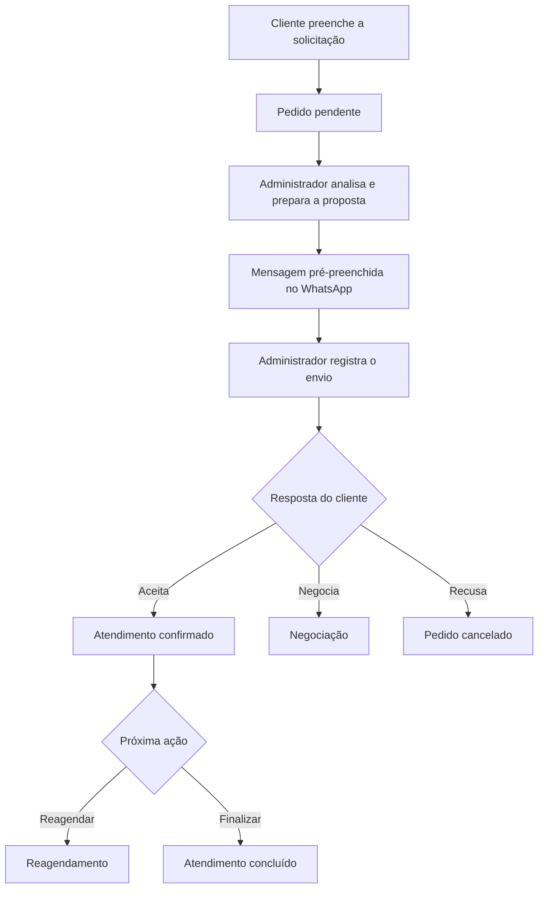
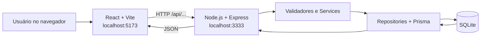

<div align="center">

# ❄️ JR Refrigerações

### Plataforma de solicitação de orçamentos e gestão de atendimentos

**Uma experiência mais simples para quem solicita um serviço e mais organizada para quem administra cada atendimento.**


</div>

---

## 📖 Sobre o projeto

O **JR Refrigerações** é uma aplicação web desenvolvida para facilitar a **solicitação de orçamentos, a organização de pedidos e o acompanhamento de atendimentos** de uma empresa de serviços de refrigeração.

O cliente pode registrar uma solicitação informando o serviço desejado, a localização, uma descrição do problema e a data de preferência. No painel administrativo, o responsável analisa os pedidos, prepara propostas, ajusta valores e datas, e acompanha cada etapa do atendimento.

A comunicação com o cliente é apoiada por **links de WhatsApp com mensagens pré-preenchidas**. O envio é realizado manualmente pelo administrador — não há disparo automático de mensagens.

> **Objetivo:** reunir as solicitações e decisões de atendimento em um fluxo organizado, reduzindo a dependência de anotações dispersas e facilitando o acompanhamento do histórico de cada pedido.

## ✨ Funcionalidades

### 👤 Área do cliente

- Consulta aos serviços e cidades disponíveis.
- Formulário de solicitação de orçamento.
- Informação de endereço, descrição do problema, data e turno de preferência.
- Registro da solicitação para análise administrativa.

### 🛠️ Painel administrativo

- Autenticação de administrador com JWT.
- Listagem de pedidos com filtros e paginação.
- Consulta detalhada das solicitações.
- Preparação e edição de propostas, com valor do serviço e taxa de deslocamento.
- Sugestão de nova data e turno durante a elaboração da proposta.
- Geração de link do WhatsApp com a proposta pré-preenchida.
- Registro manual do envio da proposta e da resposta do cliente.
- Reagendamento, conclusão e cancelamento de atendimentos.
- Lixeira e descarte periódico de pedidos conforme a política de retenção.
- Cadastro e manutenção de serviços, cidades e taxas de deslocamento.

## 🔄 Como funciona



> O sistema registra administrativamente o envio e a resposta do cliente. A confirmação não é capturada automaticamente do WhatsApp.

## 🧰 Tecnologias utilizadas

| Camada | Tecnologias |
|---|---|
| Frontend | React, Vite, JavaScript |
| Backend | Node.js, Express |
| Persistência | SQLite, Prisma ORM |
| Autenticação | JWT, bcrypt |
| Testes do backend | Node.js Test Runner (`node:test`) |

## 📁 Estrutura do repositório

```text
JR-REFRIGERA-ES/
├── backend/
│   ├── prisma/               # Schema, migrações e seed
│   ├── src/
│   │   ├── routes/           # Rotas HTTP
│   │   ├── validators/       # Validação dos dados
│   │   ├── controllers/      # Entrada e resposta HTTP
│   │   ├── services/         # Regras de negócio
│   │   ├── repositories/     # Acesso ao banco de dados
│   │   ├── middleware/       # Autenticação e outros middlewares
│   │   └── jobs/             # Tarefas periódicas
│   └── tests/                # Testes automatizados
├── frontend/                 # Aplicação React com Vite
└── README.md                 # Documentação principal do projeto
```

A API segue a organização:

**Rotas → Validadores → Controllers → Services → Repositories → Prisma/SQLite**

## 🚀 Guia completo de instalação e execução

Este repositório reúne **duas aplicações**: o **backend**, que disponibiliza a API e acessa o SQLite, e o **frontend**, que apresenta a interface no navegador e faz requisições HTTP à API. Para usar o sistema completo em desenvolvimento, **os dois servidores devem estar rodando simultaneamente**.

### Pré-requisitos

- **Node.js 22** e npm (versão utilizada durante o desenvolvimento; consulte eventuais restrições em `package.json`).
- **Git** para clonar o repositório.
- **PowerShell** no Windows (os exemplos abaixo usam esse terminal).
- Portas **3333** e **5173** livres, ou configuração equivalente.

### 1. Clonar o repositório

Abra o PowerShell na pasta onde deseja guardar o projeto:

```powershell
git clone https://github.com/Heitorhj/JR-REFRIGERA-ES.git
Set-Location JR-REFRIGERA-ES
```

A partir daqui, todos os caminhos consideram que você está na raiz `JR-REFRIGERA-ES/`, salvo quando indicado.

### 2. Instalar e configurar o backend

**Terminal 1 — backend:**

```powershell
Set-Location backend
npm ci
Copy-Item .env.example .env
```

Abra o arquivo `backend/.env` e confira os valores do `.env.example`. Configure pelo menos:

| Variável | Finalidade |
|---|---|
| `PORT` | Porta da API (padrão do projeto: `3333`) |
| `DATABASE_URL` | Caminho do arquivo SQLite utilizado pelo Prisma |
| `JWT_SECRET` | Chave privada forte usada para assinar tokens JWT |
| `ADMIN_EMAIL` | E-mail da conta administrativa inicial |
| `ADMIN_PASSWORD` | Senha da conta administrativa inicial |
| `CORS_ORIGIN` | Origem autorizada do frontend, normalmente `http://localhost:5173` |
| `RETENCAO_DIAS` | Prazo de retenção de pedidos descartados (padrão: `7`) |

> **Importante:** preserve a sintaxe de `DATABASE_URL` fornecida em `backend/.env.example`. O caminho é interpretado conforme a configuração do Prisma; não troque por um caminho absoluto sem necessidade. Não envie o `.env` ao GitHub. Use um `JWT_SECRET` forte e credenciais próprias.

**Preparar o banco e os dados iniciais:**

```powershell
npx prisma generate
npx prisma migrate deploy
npm run seed
```

- `prisma generate` cria o Prisma Client utilizado pelo código.
- `prisma migrate deploy` aplica as migrações já existentes sem gerar novas migrações.
- `npm run seed` cadastra os serviços, as cidades e o administrador inicial.

> **Para desenvolver uma nova alteração no schema:** use `npx prisma migrate dev --name nome_da_alteracao` quando realmente precisar criar uma migração. Para apenas instalar o projeto, `migrate deploy` é suficiente.

**Iniciar a API:**

```powershell
npm run dev
```

O backend deve ficar disponível em **http://localhost:3333**. Mantenha esse terminal aberto.

### 3. Instalar e iniciar o frontend

Abra **outro PowerShell** na raiz do repositório, sem encerrar o backend.

**Terminal 2 — frontend:**

```powershell
Set-Location frontend
npm ci
npm run dev
```

Abra no navegador o endereço mostrado pelo Vite, normalmente **http://localhost:5173**.

> Se o Vite escolher outra porta porque a `5173` está ocupada, atualize a origem permitida em `CORS_ORIGIN` no backend ou libere a porta original.

### 4. Como o frontend se conecta ao backend

A integração acontece por **requisições HTTP à API REST**. O React **não acessa diretamente o SQLite**; ele envia e recebe dados do Express, que executa validações, regras de negócio e operações com o Prisma.



**Exemplo de integração:**

1. O frontend solicita `GET /api/servicos` para preencher a lista de serviços.
2. O backend consulta os serviços ativos e retorna JSON.
3. O frontend apresenta as opções no formulário.
4. Ao enviar a solicitação, o frontend chama `POST /api/pedidos`.
5. O backend valida os dados e registra o pedido no SQLite.
6. O painel administrativo consulta a API para acompanhar e gerenciar os pedidos.

**Configuração necessária para a conexão local:**

- **API:** `http://localhost:3333`.
- **Interface:** `http://localhost:5173`.
- **CORS:** o backend deve autorizar `http://localhost:5173` em `CORS_ORIGIN`.
- **Cliente HTTP:** confira o arquivo `frontend/src/api/client.js` para verificar como o frontend define o endereço da API (URL absoluta ou proxy do Vite). Se usar uma variável de ambiente, configure-a conforme o código e reinicie o Vite.
- **Autenticação:** após o login, as requisições administrativas precisam enviar `Authorization: Bearer <token>`.

> **Atenção:** CORS e endereço da API são configurações diferentes. Permitir a origem no backend não faz o frontend descobrir automaticamente a URL da API. A configuração exata do cliente HTTP depende do código de `frontend/src/api/client.js` e, se existir, do proxy em `frontend/vite.config.js`.

### 5. Conferir se tudo está funcionando

Com os dois terminais abertos:

1. Acesse **http://localhost:5173**.
2. Verifique se o formulário carrega os serviços e as cidades cadastrados pelo seed.
3. Cadastre uma solicitação de teste com dados fictícios.
4. Entre na área administrativa com o e-mail e a senha definidos no `.env`.
5. Confira se o pedido aparece no painel.
6. Prepare uma proposta e confira os valores, a data e o link de WhatsApp, **sem enviar mensagens reais durante o teste**.

Se a interface carregar, mas os serviços não aparecerem, confira primeiro o **Terminal 1** e a aba **Network/Rede** das ferramentas de desenvolvedor do navegador.

### 6. Como iniciar novamente nos próximos dias

Depois da primeira instalação, **não é necessário executar `npm ci`, migrações e seed a cada inicialização**. Normalmente, basta abrir dois terminais na raiz do projeto:

**Terminal 1:**

```powershell
Set-Location backend
npm run dev
```

**Terminal 2:**

```powershell
Set-Location frontend
npm run dev
```

Execute novamente `npm ci` quando as dependências mudarem; `prisma generate` ou migrações quando houver alterações relevantes no Prisma; e o seed quando for necessário repor os dados iniciais.

### 7. Problemas comuns

| Sintoma | O que verificar |
|---|---|
| O frontend abre, mas não carrega serviços ou cidades | Confirme que o backend está rodando na porta `3333`; verifique a URL usada em `frontend/src/api/client.js` e as requisições na aba Network. |
| Erro de CORS no navegador | Confirme `CORS_ORIGIN=http://localhost:5173` (ou a origem real do Vite) no `.env` do backend e reinicie a API. |
| Erro de conexão com o banco | Confira `DATABASE_URL`, execute `npx prisma migrate deploy` e veja o erro detalhado no terminal do backend. |
| Prisma Client não encontrado | Execute `npx prisma generate` dentro de `backend/`. |
| Não consegue fazer login | Confira `ADMIN_EMAIL` e `ADMIN_PASSWORD` usados na primeira execução do seed; executar o seed novamente não altera a senha de um administrador já existente. |
| Porta ocupada | Encerre o processo que usa a porta ou ajuste a configuração; mantenha a URL do frontend, a API e o CORS coerentes. |
| Mudou o `.env`, mas nada mudou | Reinicie o processo correspondente; o servidor normalmente lê as variáveis ao iniciar. |
| Erro ao instalar dependências | Confirme a versão do Node.js, execute o comando na pasta correta e confira se existe `package-lock.json`. |

### 8. Encerrar os servidores

Em cada terminal que está executando `npm run dev`, pressione **`Ctrl + C`**.

## 🧪 Executando os testes

Na pasta `backend/`, com as dependências instaladas e o Prisma Client gerado:

```powershell
$env:JWT_SECRET = "chave-temporaria-com-mais-de-32-caracteres"
npm test
Remove-Item Env:JWT_SECRET
```

Os testes utilizam o módulo nativo `node:test` do Node.js.

## 🔌 Principais endpoints

### Públicos e autenticação

| Método | Endpoint | Descrição |
|---|---|---|
| `GET` | `/api/servicos` | Lista serviços ativos |
| `GET` | `/api/cidades` | Lista cidades ativas e taxas |
| `POST` | `/api/pedidos` | Cadastra uma solicitação |
| `POST` | `/api/auth/login` | Autentica o administrador |
| `GET` | `/api/auth/me` | Consulta o administrador autenticado |

### Administração de pedidos

| Método | Endpoint | Descrição |
|---|---|---|
| `GET` | `/api/admin/pedidos` | Lista pedidos com filtros e paginação |
| `GET` | `/api/admin/pedidos/lixeira` | Lista pedidos descartados |
| `GET` | `/api/admin/pedidos/:id` | Detalha um pedido |
| `PATCH` | `/api/admin/pedidos/:id/proposta` | Salva ou edita uma proposta |
| `GET` | `/api/admin/pedidos/:id/whatsapp` | Gera o link de WhatsApp |
| `POST` | `/api/admin/pedidos/:id/proposta/envio` | Registra o envio manual |
| `POST` | `/api/admin/pedidos/:id/resposta` | Registra a resposta do cliente |
| `POST` | `/api/admin/pedidos/:id/reagendamentos` | Registra um reagendamento |
| `POST` | `/api/admin/pedidos/:id/conclusao` | Conclui um atendimento |
| `POST` | `/api/admin/pedidos/:id/cancelamento` | Cancela um pedido |

Também existem rotas administrativas para gerenciar **serviços, cidades e taxas de deslocamento**.

As rotas administrativas exigem autenticação:

```http
Authorization: Bearer <token>
```

### 💰 Valores monetários

Os valores são transmitidos e armazenados em **centavos**, evitando o uso de números decimais para representar dinheiro.

Por exemplo, `20000` representa **R$ 200,00**.

## 🔐 Segurança e cuidados

- Autenticação administrativa com JWT.
- Senhas protegidas com bcrypt.
- Validação e normalização de dados antes das regras de negócio.
- Operações de persistência organizadas em repositories com Prisma.
- Variáveis sensíveis mantidas em arquivo `.env` local.
- Envio de mensagens pelo WhatsApp realizado manualmente pelo administrador.

> Este repositório utiliza SQLite para execução local e desenvolvimento. Antes de publicar o sistema em produção, revise a configuração de ambiente, persistência, permissões e política de segurança.

## 🗑️ Retenção de dados

Pedidos cancelados ou recusados podem ser marcados para descarte. Um job periódico realiza o expurgo conforme o prazo configurado em `RETENCAO_DIAS` (padrão de **7 dias**) e remove clientes que não possuam outros pedidos.

## 📌 Contexto do desenvolvimento

O projeto foi desenvolvido com foco em **aplicar conceitos de desenvolvimento web full stack**, incluindo arquitetura em camadas, construção de APIs REST, validação de dados, autenticação, modelagem relacional e integração entre frontend e backend.

---

<div align="center">

**JR Refrigerações** · Organização, praticidade e acompanhamento de atendimentos.

</div>
